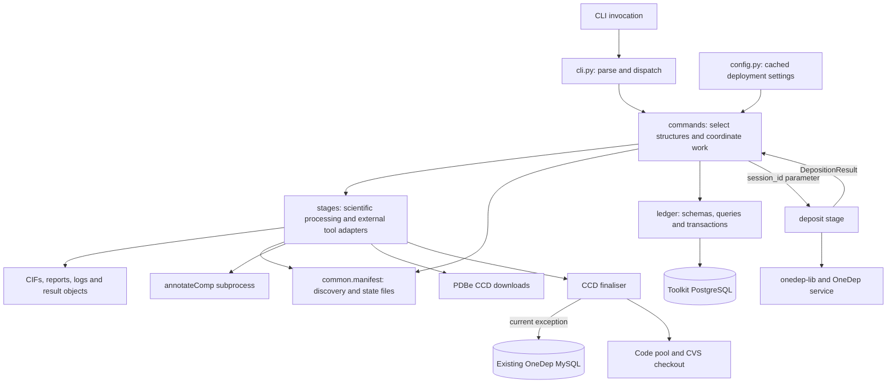
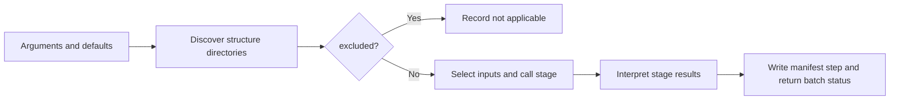
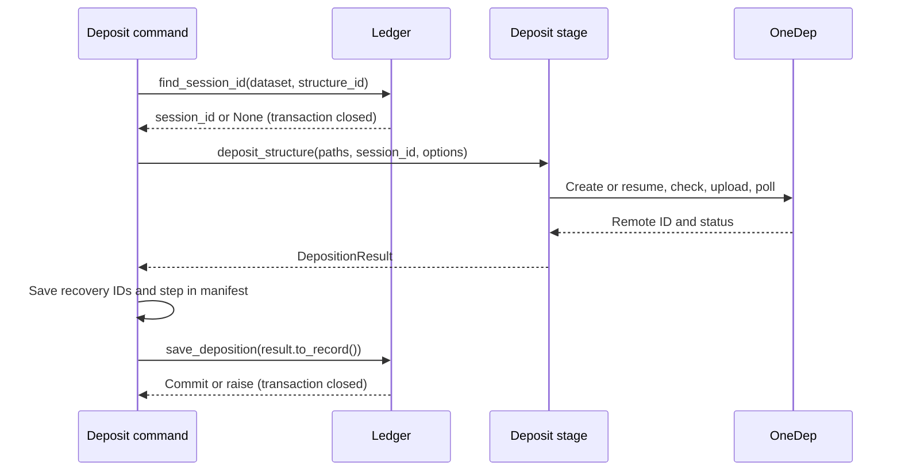

[Documentation home](index.md) · [Data and state](data-and-state.md) · [Developer guide](development.md)

# Architecture and dataflow

The toolkit is a filesystem-oriented set of stages with a thin batch CLI. Files carry the scientific data; per-structure manifests carry processing state and provenance. Commands coordinate stages and translate persistence results into ordinary parameters.

## Responsibility boundaries

The arrows represent calls or data dependencies, not concurrent execution. The current wrappers process structures sequentially. Prefect is declared as a dependency but is not used by the current source to schedule this workflow.

| Layer | Owns | Should not own |
| --- | --- | --- |
| `cli.py` | Global logging, parser construction, command dispatch | Stage algorithms or database queries |
| `commands/` | Per-command arguments, batch selection, settings overrides, logs, result interpretation, manifest step status | Reimplementing scientific transformations |
| `commands/shared.py` | Step-name constants, excluded filtering, results directories, stage logging | Command-specific chemistry |
| `stages/` | File parsing/transformation, external tools, stage result values, independent script interfaces | Toolkit PostgreSQL sessions or ORM objects |
| `stages/common/manifest.py` | Discovery rules, JSON read/write, shared file selection | Enforcing a workflow dependency graph |
| `ledger/` | Validated identities, database operations, SQLAlchemy models, short transactions, migrations | Long-running uploads or scientific processing |
| `config.py` | Deployment settings and derived annotation executable path | OneDep authentication/session lifecycle |

## Four design decisions

### 1. Stages remain independently executable

Stage algorithms can be imported directly and most expose `main()` or a script entry point. Prefer `python -m deposition_toolkit.stages.…` within the installed project environment; this provides the package imports that shared helpers require. “Standalone” means independent of the batch CLI, not a dependency-free file that can always be copied elsewhere.

Direct stage execution usually omits wrapper exclusion filtering, batch log routing, and step-status recording. It does not necessarily omit manifests: preparation initializes manifests, CCD creation writes `ccd_ligands`, and ligand renaming/deposition read manifests. See [standalone entry points](development.md#running-stages-independently).

### 2. Commands wrap the stages

Each command module registers an argparse subcommand through `register(subparsers)` and supplies `run(args)`. `COMMAND_MODULES` in `commands/__init__.py` is the registry. The top-level dispatcher calls the selected runner and returns its integer result.

Most wrappers share this shape:

Preparation and ledger administration have different lifecycles. CCD finalisation operates across the selected batch so identical InChIKeys share decisions. See [command internals](commands/index.md).

### 3. Each structure has a manifest

Manifests provide portable state beside source files. The top level holds identity, exclusion, chain classification, ligand provenance, and known deposition IDs. `steps` holds the latest result for each step. Shared writes replace JSON atomically; the manifest is not an append-only audit log or a locking mechanism. [Data and state](data-and-state.md) specifies this contract.

### 4. Database values cross the command boundary as parameters/results

The toolkit ledger follows this design. `commands/deposit.py` performs lookup through `ledger/depositions.py`, passes `session_id` into `deposit_structure()`, and persists `result.to_record()` after the stage returns. No live transaction spans the upload.

**Current exception:** `stages/ccd_creation/finalise_step/finalize_ccds.py` imports `mysql.connector` and queries existing CCD descriptors itself. `--existing-descriptors-file` bypasses that dependency. A future refactor can move descriptor acquisition to a command-side adapter and pass `dict[InChIKey, set[CCD]]` into the decision logic. This is a design direction, not implemented behavior.

## Source map

Paths below are relative to `src/deposition_toolkit/`.

| Module family | Main responsibilities |
| --- | --- |
| `stages/prepare_dataset/prepare_dataset.py` | Archive copy/extraction, dataset naming, initial manifests |
| `stages/prepare_dataset/dep_report.py` | CIF block classification, consistency checks, submission PDF |
| `stages/validate/mmcif_validate.py` | Dictionary validation and grouped logs |
| `stages/analyse_chains/analysis_polymer_chains.py` | Gemmi polymer chain inspection |
| `stages/metadata_enrichment/enrich_cif.py` | ID normalization, JSON overlay, cached CCD enrichment |
| `stages/ccd_creation/ccd_creator.py`, `rdkit_ligand.py` | Per-instance CCD inputs, chemistry analysis and diagrams |
| `stages/ccd_creation/annotate_comp.py` | Two rounds of the external annotation binary |
| `stages/ccd_creation/finalise_step/` | Descriptor matching, deduplication, allocation, CCD rewriting, CVS helper |
| `stages/ccd_creation/ligand_renaming/` | Provenance-checked coordinate and reference edits |
| `stages/resolution_cleanup/resolution_cleanup.py` | Resolution/statistic rounding, shell sorting, cutoff synchronization |
| `stages/deposit/deposition.py` | OneDep lifecycle and serializable results |
| `stages/validation_report/val_report.py` | Standalone post-deposition dashboard; no registered toolkit command |
| `scripts/` | Earlier launchers/batch recipes; not the command registry and not the canonical workflow |

For repository source, start at [the package](https://github.com/PDBeurope/deposition-toolkit/tree/main/src/deposition_toolkit). The `main` branch link may differ from a local checkout's revision; module names above identify the implementation to inspect.
