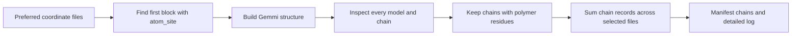

[All commands](index.md) · Previous: [validation](mmcif-validation.md) · Next: [enrichment](enrich-metadata.md)

# analyse-chains

**Wrapper:** `commands/analyse_chains.py` → **stage:** `stages/analyse_chains/analysis_polymer_chains.py`, `process_single_file()`.

For each model/chain, `get_polymer_chains()` counts residues with `entity_type == gemmi.EntityType.Polymer`. It records model index, chain name, polymer and total residue counts, and the number of residue types. `--verbose-chains` adds names of residue types and first/last sequence information.

The wrapper sums returned chain records across coordinate files. One gives `chains: single`, more than one gives `multiple`, and zero gives `none`; any reported file error clears the label and fails the structure. No coordinate files also fails. A parsed file without coordinate content does not add to the count.

**Outputs:** `results/logs/analyse_chains/<structure>.log`; manifest step includes aggregate `polymer_chain_count` and per-file chain details. Coordinate data is not edited by the wrapper.

**Edges:** this is a count of model/chain records, not a count of unique chain names or biological assemblies. A repeated chain in two models counts twice. The standalone directory mode has its own directory classification behavior; it is not what the batch wrapper invokes.
