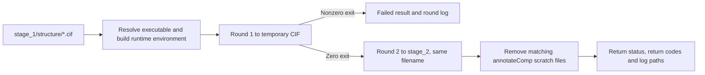

[All commands](index.md) · Previous: [creation](ccd-creation.md) · Next: [finalisation](ccd-finalise.md)

# ccd-annotate

**Wrapper:** `commands/ccd_annotate.py` → **stage:** `stages/ccd_creation/annotate_comp.py`, `annotate_file()` → external `annotateComp` executable.

This stage is primarily an external tool adapter. It does not implement the individual chemistry operations itself.



Each subprocess uses an argument list, captures stdout/stderr and runs with `check=False`. Exact command shape:

```text
annotateComp -vv -i INPUT -o OUTPUT -op OPERATIONS
```

| Round | Exact operation string |
| --- | --- |
| 1 | `stereo-cactvs\|aro-cactvs\|descriptor-oe\|xyz-ideal-corina\|xyz-model-h-oe\|fix` |
| 2 | `descriptor-cactvs\|name-oe\|descriptor-inchi\|rename` |

Round 1 writes into a temporary directory; round 2 writes the requested final file. Logs contain the command, return code, stdout and stderr. The runtime environment points to the configured toolkit, OpenEye license, CACTVS, CORINA, OpenBabel and InChI paths; see [configuration](../configuration.md#annotation-tools).

**Outputs:** `results/ccd/stage_2/<structure>/<ligand>.cif`; logs at `results/logs/ccd_annotate/<structure>/<stem>.round1.log` and `.round2.log`. Filenames preserve the provenance join key. Manifest step records each file's status and return codes. No stage-1 files gives `not applicable` and does not itself fail the batch.

**Edges:** executable resolution checks file presence or `PATH`, not full runtime compatibility. A nonzero subprocess return produces a failed result; spawn/permission exceptions can propagate out of the wrapper. Success is based on exit codes, not independent output-CIF validation. The stage cleans `__LIG__CCEX__TMP*` in the current working directory after round 2. There is no subprocess timeout. Old stage-2 outputs are not removed before a retry.
