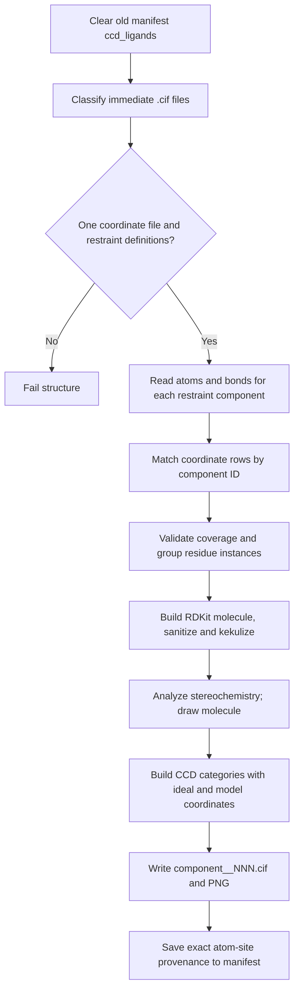

[All commands](index.md) · Previous: [enrichment](enrich-metadata.md) · Next: [annotation](ccd-annotate.md)

# ccd-creation

**Wrapper:** `commands/ccd_creation.py` → **stage:** `stages/ccd_creation/ccd_creator.py`, `CcdDirectoryBuilder.run()` → `rdkit_ligand.py`.

## Input and grouping contract

Discovery uses content, not `_struc` / `_lig` filenames: `_atom_site` identifies coordinates; restraint definitions require component atom/bond data. Exactly one coordinate `.cif` must exist. Restraint component IDs must be unambiguous, match coordinate components, and not contain coordinate atom names missing from the restraint definition.

For a restraint document with two or more blocks, the loader uses the **second block** and ignores the first; with one block it uses that block. Duplicate restraint definitions for the same component are rejected.

Instances group on alternate ID, component ID, label asym/entity/sequence IDs, insertion code, author sequence/asym IDs, and model number. Each becomes `<comp_id>__001.cif`, `__002.cif`, etc. Stored provenance includes coordinate filename and block, original component, exact atom IDs and the entire instance key.

## Chemistry construction

- Restraints supply atom names/elements, ideal coordinates and bonds. Matching coordinate atoms supply model coordinates; unavailable model coordinates stay missing.
- Element mismatches fail. Output atom `charge` is currently hardcoded to `0`; nonzero restraint partial charges are logged rather than translated into formal charges.
- RDKit builds a molecule and 3D conformer, sanitizes it, kekulizes aromatic bonds and assigns stereochemistry. Bond orders emitted to CIF are `SING`, `DOUB`, or `TRIP`; aromatic flags derive from source aromatic bonds.
- Unassigned stereocenters are enumerated. The first enumerated stereoisomer supplies analysis descriptors and the diagram; ambiguity generates a warning. The stage's RDKit InChIKey/SMILES are analysis/log results, not the finaliser's descriptor source, which comes from annotated CIFs.
- Generated data includes component summary, atom/bond loops and audit metadata. Audit values currently include processing site `PDBE`, annotator `GE`, and details `Created for OpenBind`.

**Outputs:** `results/ccd/stage_1/<structure>/<component>__NNN.cif` and `.png`; `results/logs/ccd_creation/<structure>.log`; top-level `ccd_ligands`. The wrapper lists generated CIFs and `ccd_count`; diagrams are additional artifacts. Zero generated files or an exception fails the structure.

**Edges:** alternative conformations are separate instances, so shared/missing atoms deserve review. Missing atoms in the RDKit conformer are left at default positions; this can affect stereochemistry. Unknown source bond types fall back to single in the RDKit mapping. Creation clears earlier manifest allocations before processing, but does not clear stale output CIFs/PNGs. Rebuild into reviewed output directories to avoid annotating old instances.
