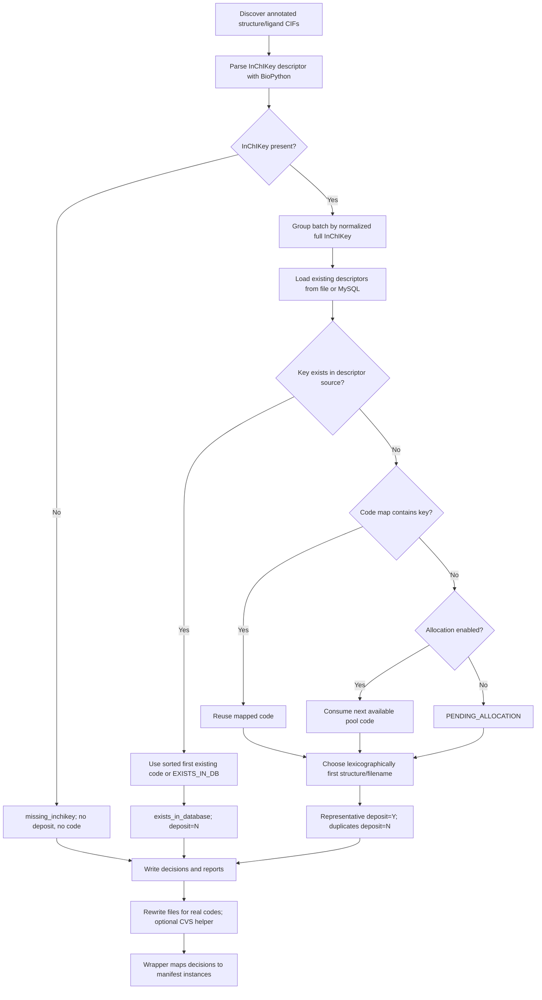

[All commands](index.md) · Previous: [annotation](ccd-annotate.md) · Next: [renaming](lig-rename.md) · [All options](../cli.md#ccd-finalisation-options)

# ccd-finalise

**Wrapper:** `commands/ccd_finalise.py` → **stage:** `stages/ccd_creation/finalise_step/finalize_ccds.py` → allocation, rewriting and CVS helpers in the same directory.

Finalisation is a batch operation because different structures can contain the same chemistry. Matching uses normalized **full InChIKey strings**, not a structural similarity search.

## Wrapper boundary

The wrapper clears `CCD`/`finalisation` on each active structure's existing provenance. It exposes only active stage-2 directories to the stage through a temporary tree, using symlinks or a copy fallback. Missing stage-2 directories get `not applicable`. `--commit-only` bypasses ordinary processing and manifest mapping.

After successful stage execution, the wrapper reads `ccd_processing_details.csv`, joins rows by structure basename and `ligand_name`, and adds codes/metadata to the original instance records. Unexpected ligand names, missing/duplicate rows, missing InChIKeys or placeholder codes fail the structure. Mapping errors remove codes from all that structure's records. If stage execution returns nonzero, the wrapper does not ingest its details CSV.

## Decision tree



## Descriptor input

Without `--existing-descriptors-file`, the stage opens MySQL and executes:

```sql
SELECT comp_id, descriptor
FROM compv4.pdbx_chem_comp_descriptor
WHERE type='inChikey'
```

The connection closes in `finally`. This is the current exception to command-only database access. A check logs when fewer than `55,650` unique descriptors load, but its `SystemExit(0)` is instantiated without being raised: **it does not stop processing**.

A descriptor cache can be CSV/TSV, preferably with `comp_id,descriptor` headers. Header aliases include `inchi_key`/`inchikey` and `ccd`/`ccd_id`/`id`. Two-column headerless files mean component then descriptor; one-column files mean descriptor without known code. Existing descriptor keys with no code produce `EXISTS_IN_DB`, which the wrapper rejects for renaming. Multiple codes for one key are sorted; the first is chosen and all are reported in `db_matches`.

Code-map CSVs require headers identifying `inchi_key`/`inchikey`/`descriptor` and `ccd`/`ccd_id`/`comp_id`. Later duplicate keys overwrite earlier ones. Existing descriptor matches take precedence over supplied code maps.

## Allocation and rewriting

For each new, unmapped key, `--allocate-codes` calls `get_next_unused_code()` once. The helper scans the pool, skips codes whose component files exist under `CCD_CVS_PATH`, selects the first absent one, and rewrites the pool without the checked prefix. Three-character components hash by first character; longer codes use the final two characters. There is no inter-process lock or transactional allocation across the batch.

`allocated_ccd_codes.csv` is flushed after each allocation with key, code and timestamp. It is opened for writing on an allocating run; preserve previous copies before retrying and supply them through `--code-map-file`.

`rename_ccd.update_cif_ligand()` is a **text/regex rewrite of generated CCD files**, separate from the coordinate-aware `lig-rename` algorithm. It fills a missing component name from a matched systematic identifier, replaces `data_<old-id>` and whitespace-delimited old-ID occurrences. Its assumptions depend on annotateComp's output layout and `--old-id` (default `LIG`).

## Outputs

All under `results/ccd/final/`:

| Output | Meaning |
| --- | --- |
| `ccd_processing_summary.csv` | Structure, ligand filename, deposit flag and CCD |
| `ccd_processing_details.csv` | Above plus key, status, representative, matches and source path |
| `ccd_processing_result.json` | Counts and artifact locations |
| `ccd_processing.log` | Finaliser log |
| `allocated_ccd_codes.csv` | Allocations made in this run, if any |
| `renamed_by_structure/<structure>/<CCD>.cif` | All mapped ligands with real codes |
| `new_ccds/<CCD>.cif` | One new representative per key, ready for CVS review |
| `ccds_to_commit.txt` | Sorted unique new representative codes |

`deposit=Y` refers to a **new CCD representative**, not the later structure upload. Mapped instances sharing a CCD in one structure use the same output filename, so later writes replace earlier ones. Optional `--copy-to-structure-folders` writes beside the stage-2 source, not beside original coordinates. With symlinks this reaches the actual stage-2 directory; with the copy fallback those additions stay in the temporary tree and disappear. Reports can contain temporary source paths after the wrapper removes that tree.

## CVS modes

| Mode | Behavior |
| --- | --- |
| `never` | Default; no CVS helper |
| `dry-run` | Require commit message; show intended directory creation, copying, adds and commits without making them |
| `prompt` | Require a TTY, commit message, and exact `COMMIT_CCDS` response; then run helper |

The helper accepts only three- or five-character alphanumeric CCD filenames, rejects duplicate source IDs, creates hash directories, copies files into the checkout, runs `cvs add` where needed and commits each component separately. It can partially succeed across components. There is no global rollback. `--cvs-path` changes the commit destination but not allocation checks.

**Review limits:** a preview still writes reports and mapped CCD outputs. Pending codes are a successful standalone preview but a failed wrapper mapping. Stale `new_ccds` files are not purged and the commit helper scans its entire folder; inspect it before committing. Existing key matches establish descriptor equality, not a complete chemistry quality assessment. `is_real_ccd_id()` only rejects blank and known placeholder values; the later CVS helper has stricter length/character checks.
