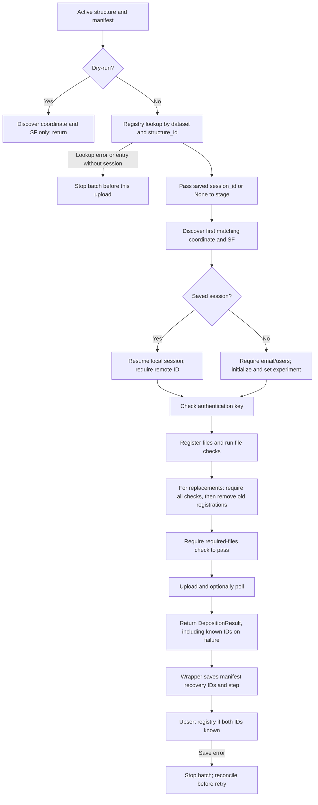

[All commands](index.md) · Previous: [cleanup](resolution-cleanup.md) · [Configuration](../configuration.md#onedep-identity-authentication-and-saved-sessions) · [Recovery](../recovery.md)

# deposit

**Wrapper:** `commands/deposit.py` → **stage:** `stages/deposit/deposition.py`, `deposit_structure()` → `onedep-lib`.

The stage handles remote/session behavior; the wrapper owns registry lookup, manifest status and database persistence. File patterns and dataset identity are specified in [data and state](../data-and-state.md).

## Command and stage sequence

## File checks and replacement behavior

The stage registers the coordinate as `MMCIF_COORD` and reflections as `CRYSTAL_STRUC_FACTORS`. It records coordinate mmCIF, `_atom_site`, and file-type checks, plus SF mmCIF and file-type checks. Authentication failure or missing required files stops upload.

For a resumed session, every replacement check must pass before old file registrations of those two types are removed. Failed replacement checks remove newly registered files and preserve old registrations. Saved depositor and experiment settings are retained; new CLI values do not redefine them.

For a **new** session, individual file-check results are recorded but are not all explicitly gated before upload; `check_required_files().ok` is the final explicit gate. These paths therefore have different validation guarantees. Remote validation is not a substitute for inspecting earlier toolkit results, which are not prerequisites enforced by this command.

## Polling semantics

After `dep.deposit()` returns, the stage marks status `done`. With polling enabled (default), it requests status up to `64` times at `5` second intervals. A `DepositError` or status string `error` changes status to `failed`; `finished` ends polling successfully. Exhausting the poll budget leaves the current `done` status. `--no-poll` returns after upload without waiting for remote completion.

Consequently, toolkit `done` means the upload path returned without a detected failure; it does not always establish that remote processing finished. Inspect `final_status` and the remote deposition when needed.

## Persistence and recovery

`DepositionResult` carries identity, status, selected files, file IDs, check reports, final status, errors and known remote/session IDs. `to_record()` returns `dep_id`, `dataset`, `structure_id`, `session_id` as plain strings.

The wrapper stores the result under `steps.deposition`. If a remote ID is known, it also saves top-level `deposition_id`/`session_id` and `deposition_record`. When both IDs exist it upserts the registry even if processing failed, allowing retries to find the same remote deposition. A save error stops the batch after manifest recovery details are written. Lookup errors also stop the batch; earlier structures may already have uploaded.

**Dry-run:** bypasses PostgreSQL and OneDep imports/config/authentication/session creation; it requires matching coordinate/SF files and writes a result/log/manifest. It does not validate file content.

**Edges:** missing local session files cannot be repaired from a remote ID alone. The wrapper uses the registry rather than top-level manifest IDs for session lookup. A created session with no remote ID is not persisted to the registry by this wrapper; inspect local session storage on such failures. Remote upload and registry upsert are not one atomic operation. Repeated commands intentionally replace remote files, not simply skip `done` structures. An injectable Python `session_lookup` can replace lookup in `commands.deposit.run()`, but normal result persistence still runs.
