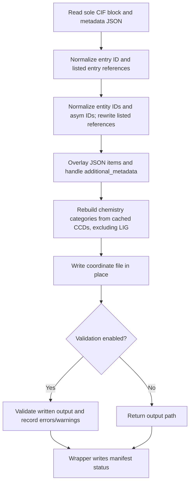

[All commands](index.md) · Previous: [chains](analyse-chains.md) · Next: [CCD creation](ccd-creation.md)

# enrich-metadata

**Wrapper:** `commands/enrich_metadata.py` → **stage:** `stages/metadata_enrichment/enrich_cif.py`, `enrich_cif_file()`.

The wrapper passes each selected coordinate path as both input and output. Unlike the earlier shell recipe, it does not create an `_enriched_struc.cif` sibling.



## Metadata format

Top-level category names map to item dictionaries. Scalars become one-element lists, lists remain lists, and JSON nulls are skipped. Values replace whole item columns; this is not a row-key merge.

```json
{
  "_audit_author": {
    "name": ["Example, A.", "Example, B."],
    "pdbx_ordinal": ["1", "2"]
  },
  "additional_metadata": {
    "xray_exp_type": "single"
  }
}
```

This is a minimal shape example, not a complete deposition metadata record. Provide internally consistent column lengths and appropriate categories for the dataset. One JSON file applies across the batch; assigning one identical `_struct.title` across structures conflicts with the report's title-uniqueness check.

## Transformations and order

| Operation | Exact rule |
| --- | --- |
| Entry normalization | Set `_entry.id`, selected entry references and output block name to `--entry-id` (default `model`) |
| Entity IDs | First-seen unique `_entity.id` values become `1`, `2`, … |
| Asym IDs | First-seen unique `_struct_asym.id` values become `A` … `Z`, `AA`, … |
| Reference rewrites | Entity references in `_struct_asym`, `_atom_site`, `_entity_poly`, `_entity_src_gen`, `_entity_poly_seq`; asym references in `_atom_site` and both `_struct_conn` partners |
| JSON overlay | Runs after normalization, so metadata can overwrite normalized items |
| X-ray enrichment | `single`, `laue`, `mad` only; require exactly one radiation row, set `diffrn_id=1`, fill empty protocol/monochromatic/scattering values |
| CCD enrichment | Unique atom-site components excluding literal `LIG`; rebuild `_chem_comp`, `_chem_comp_atom`, `_chem_comp_bond` with selected columns, sequential ordinals and lowercase bond orders |
| Serialization | Convert `?` values to null representation; write a newly constructed single-block document |

CCD downloads use the PDBe CCD endpoint constructed in the source. Cache is `.ccd_cache/` under the process working directory, with `cache_details.json` timestamps and a 30-day expiry. HTTP requests time out after 15 seconds. This is separate from the finaliser's MySQL descriptor snapshot.

**Outputs:** edited coordinates and `results/logs/metadata_enrichment/<structure>/<stem>_validation_errors.txt` unless validation is skipped. Manifest step counts validation errors and warnings. Errors fail; warnings alone do not. Per-file exceptions, including `SystemExit` from validation assumptions, are collected by the wrapper.

**Edges:** writing happens **before** output validation, with no automatic restore on failure. `sole_block()` rejects multi-block documents. Reference normalization covers a fixed list, not every dictionary-defined foreign key. CCD-fetch failures are logged and add a minimal component fallback; they do not automatically fail the wrapper. The JSON overlay's chemistry categories can subsequently be replaced by CCD enrichment. Sequence updating is commented out and does not execute. Do enrichment before creating ligand provenance; subsequent ID changes can invalidate it.
