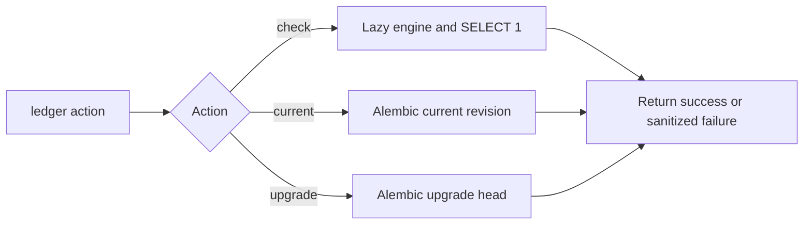

[All commands](index.md) · [Architecture](../architecture.md) · [Registry schema](../data-and-state.md#deposition-identity-and-postgresql)

# ledger

**Wrapper:** `commands/ledger.py` → `ledger/database.py` or Alembic using `ledger/alembic.ini` and `ledger/migrations/`.



`check` verifies connectivity without creating tables. `current` displays the applied migration revision. `upgrade` applies revisions through head and creates Alembic's version table to track the applied revision; `0001` is an empty baseline, `0002` creates `deposition_registry`, and `0003` creates `structures`. PostgreSQL and its login role must already exist.

## Load structure manifests

```bash
deposition-toolkit ledger upgrade
deposition-toolkit ledger load-manifest work/path_to_structures/
```

The loader discovers structures recursively using the shared discovery rules, including excluded structures. Every discovered structure must have a valid `manifest.json` with non-empty `group_id` and `structure_id`. All input manifests must share one group and dataset, with distinct structure IDs. The dataset comes from an explicit `dataset` field when present, otherwise from the source archive recorded in `source_tarball` or `steps.prepare_dataset.source_tarball` (using the same naming rules as deposition). Missing manifests, invalid JSON, or inconsistent identities fail the entire batch before writing anything.

`structures` has an integer primary key `id`, text columns `group_id`, `dataset`, and `structure_id`, and a PostgreSQL JSONB `structure_details` column containing the complete manifest. `(group_id, structure_id)` is unique; `group_id` is indexed. JSONB preserves JSON content rather than file formatting or key order. Local manifests are not modified.

If any rows already exist for the group, the command warns with the number of incoming structures that already exist and the number that are new, then asks `Do you wish to override all data? [y/N]`. Only `y` or `yes` (case-insensitive) approves. A negative or empty answer, end-of-input, or interruption at the prompt cancels without writing data and returns zero.

On approval, matching rows retain their IDs and receive replacement manifest details, while new structures are inserted. Existing rows absent from the input are retained. A group cannot be reused for a different dataset. All writes commit together or roll back together. Loaders serialize writes for the same group; if its structure membership changed while awaiting approval, the command fails and asks the operator to rerun with updated counts. New groups load without prompting. There is no automatic-approval flag.

The SQLAlchemy engine is cached and created lazily, uses `pool_pre_ping`, hides query parameters, and sets a ten-second connect timeout. Importing ledger modules or displaying help does not connect. Normal stage execution does not auto-create tables.

`session_scope()` creates a short transaction that commits on success, rolls back on failure and closes its session. Registry operations validate inputs with Pydantic and return ordinary values; no ORM objects or sessions reach stages. The deposit wrapper closes lookup work before starting OneDep work.

The command catches configuration/Pydantic/Alembic command errors and SQLAlchemy errors, logs an appropriate failure and returns one. Driver failures use a generic message to avoid exposing credentials/query details. Success returns zero.

For model changes and migration generation, follow the [developer guide](../development.md#database-changes). There is no toolkit `ledger downgrade` subcommand; use the explicit Alembic configuration when intentionally managing other migration actions.
