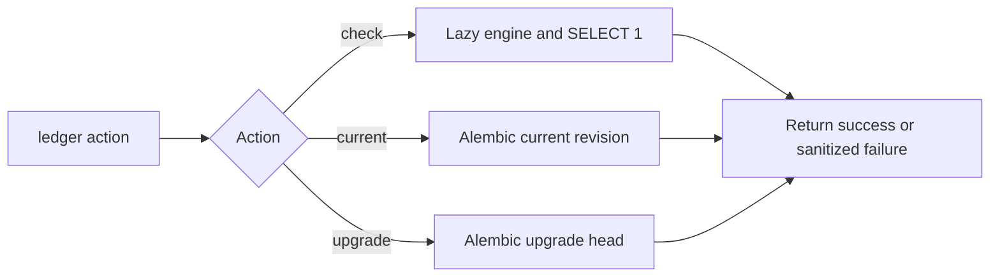

[All commands](index.md) · [Architecture](../architecture.md) · [Registry schema](../data-and-state.md#deposition-identity-and-postgresql)

# ledger

**Wrapper:** `commands/ledger.py` → `ledger/database.py` or Alembic using `ledger/alembic.ini` and `ledger/migrations/`.

`check` verifies connectivity without creating tables. `current` displays the applied migration revision. `upgrade` applies revisions through head; `0001` is an empty baseline and `0002` creates `deposition_registry`. PostgreSQL and its login role must already exist.

The SQLAlchemy engine is cached and created lazily, uses `pool_pre_ping`, hides query parameters, and sets a ten-second connect timeout. Importing ledger modules or displaying help does not connect. Normal stage execution does not auto-create tables.

`session_scope()` creates a short transaction that commits on success, rolls back on failure and closes its session. Registry operations validate inputs with Pydantic and return ordinary values; no ORM objects or sessions reach stages. The deposit wrapper closes lookup work before starting OneDep work.

The command catches configuration/Pydantic/Alembic command errors and SQLAlchemy errors, logs an appropriate failure and returns one. Driver failures use a generic message to avoid exposing credentials/query details. Success returns zero.

For model changes and migration generation, follow the [developer guide](../development.md#database-changes). There is no toolkit `ledger downgrade` subcommand; use the explicit Alembic configuration when intentionally managing other migration actions.
