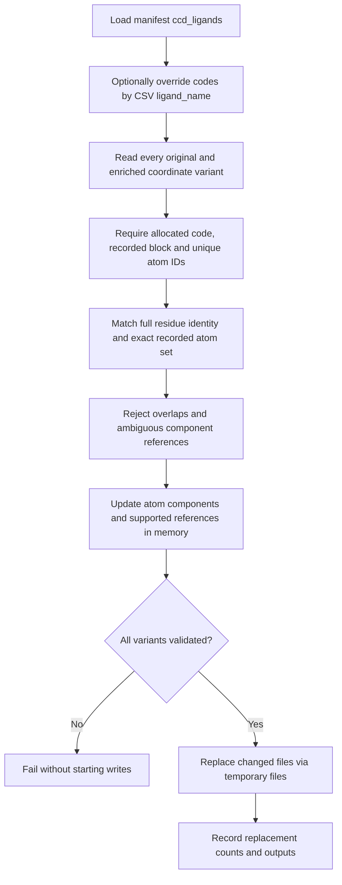

[All commands](index.md) · Previous: [finalisation](ccd-finalise.md) · Next: [resolution cleanup](resolution-cleanup.md)

# lig-rename

**Wrapper:** `commands/lig_rename.py` → **stage:** `stages/ccd_creation/ligand_renaming/lig_renaming.py` → `instance_rename.rename_document()`.

This edits parsed CIF categories using per-instance provenance, rather than globally replacing the string `LIG`.

## Identity checks

Each mapping must have an alphanumeric allocated code, a source block, a nonempty unique atom-ID list and residue identifiers including component ID. `_atom_site.id` must be present and unique. The complete matching instance in the current document must equal the recorded atom-ID set. The original component or its already-renamed target is allowed, enabling repeated successful renaming. All other recorded instance fields must still match.

Overlapping mappings fail, even if they request the same code. Missing provenance requires rerunning CCD creation, annotation and finalisation. `--summary-csv` only overrides codes: each structure's CSV ligand-name set must exactly match its manifest records, with one row per name.

## Updated categories

| Category | Edits |
| --- | --- |
| `_atom_site` | Selected rows' `label_comp_id` and existing `auth_comp_id` |
| `_pdbx_nonpoly_scheme` | Component columns resolved through residue/asym/entity context |
| `_pdbx_entity_nonpoly` | Component references resolved by entity |
| `_struct_conn` | Both partners' label/author component references resolved by available residue/atom identifiers |
| `_atom_site_anisotrop` | Component references resolved by atom ID |
| `_chem_comp` | Expand/deduplicate summary rows when one original component maps to several target codes |

A reference matching more than one target code is ambiguous and fails. Unrelated free text is left alone; the implementation does not rewrite every possible chemistry category or dictionary-defined component reference.

**Outputs:** coordinate files in place, `results/logs/lig_rename.log`, manifest step paths and `replacements`. A successful CSV override also saves updated codes in `ccd_ligands`. Zero replacements is valid on an idempotent rerun.

**Edges:** validation happens across all coordinate variants before any writes, but replacement is atomic only per file. An I/O failure during the write loop can leave some variants changed. No backup is generated. Enrichment or other ID-changing operations after creation can invalidate provenance; recreate it deliberately and reuse existing allocations through a code map.
