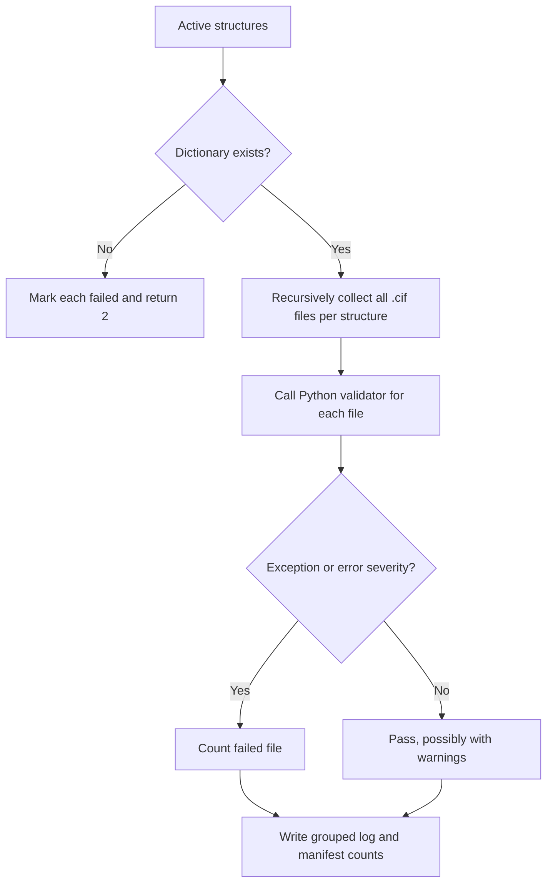

[All commands](index.md) · Previous: [submission report](submission-report.md) · Next: [chain analysis](analyse-chains.md)

# mmcif-validation

**Wrapper:** `commands/mmcif_validation.py` → **stage:** `stages/validate/mmcif_validate.py` → Python `validate_mmcif.validate(dictionary_path, cif_path)` from the validator dependency. This command does not launch an external binary.

The stage captures validator exceptions per file. Severity `error` increments error counts and fails the file; severity `warning` increments warning counts without failing it. An empty matched file list counts as one failed-file outcome. The wrapper returns one if any files fail, otherwise zero.

**Output:** `results/logs/mmcif_validation/<structure>_validation.log`, containing input paths, dictionary, per-file diagnostics and aggregate counts. Manifest step fields include `files`, `failed_files`, `errors`, `warnings` and log path. Source CIFs are not modified.

**Edges:** directory expansion always uses recursive `rglob('*.cif')` despite the wrapper passing `recursive=False`; this includes restraint and generated `.cif` files below the structure. `.mmcif` and compressed inputs are not selected by that directory rule. No-match and missing-dictionary outcomes differ. Standalone mode accepts file/directory/glob inputs with its own parser; consult its `--help`.
