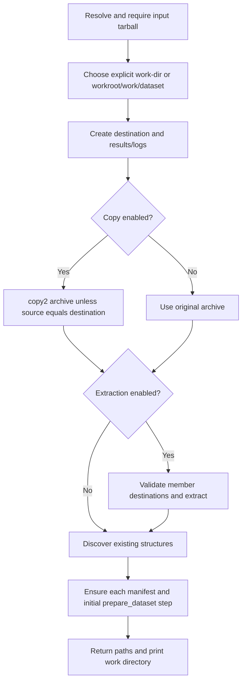

[All commands](index.md) · [CLI](../cli.md) · Next: [submission-report](submission-report.md)

# prepare-dataset

**Wrapper:** `commands/prepare_dataset.py` → **stage:** `stages/prepare_dataset/prepare_dataset.py`, `prepare_dataset()`.

## Flow

## Exact behavior

The stage strips `.tar.gz`, `.tar.bz2`, `.tar.xz`, `.tgz`, `.tbz2`, `.txz`, or `.tar` when deriving the dataset directory; otherwise it uses the filename stem. The archive must exist even with `--no-extract`. `--no-copy` leaves the source archive in place; it does not disable extraction.

Before extraction, each member's resolved destination must remain inside the target directory. Python 3.13's tar extraction behavior still applies; the explicit check is not a separately implemented comprehensive archive security policy.

The shared discovery helper identifies structure directories. Preparation records the original tarball path, resolved work directory, UTC timestamp and recognized outputs. Existing preparation steps are preserved, as are existing top-level manifest fields.

**Outputs:** copied archive unless disabled, extracted files unless disabled, per-structure manifests, `PrepareDatasetResult(tarball, work_dir, copied_tarball, structure_dirs)`. The wrapper prints `work_dir` and returns zero if the stage returns, even with no structures.

**Edges:** extraction can overwrite files in an existing work directory; it does not clear old files first. A failed extraction can leave partial files. Preparation does not apply excluded filtering. `--no-extract` is useful for initializing existing extracted content but does not verify that content against the archive.
