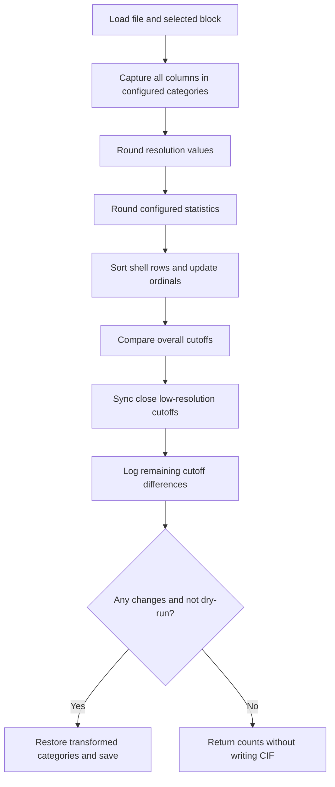

[All commands](index.md) · Previous: [ligand renaming](lig-rename.md) · Next: [deposition](deposit.md)

# resolution-cleanup

**Wrapper:** `commands/resolution_cleanup.py` → **stage:** `stages/resolution_cleanup/resolution_cleanup.py`, `ResolutionWorkflow.process()`.

The wrapper loads `BatchConfig` or explicit YAML, applies CLI file/block overrides, then processes matching files in active structures. It directly invokes the processing API; the standalone script's overwrite-confirmation flow does not run in the wrapper.

All five operations are enabled by default; YAML can disable them individually. The default file pattern is `*_struc.cif`, block index `0`, and empty suffix (overwrite input).

| Operation | Exact behavior |
| --- | --- |
| Resolution rounding | Two decimal places in `_reflns.d_resolution_high/low`, `_refine.ls_d_res_high/low`, and shell `d_res_high/low` fields |
| Statistic rounding | Three decimal places for configured CC-half, R-merge/R-pim/R-rim, intensity/sigma, redundancy and completeness columns in `_reflns` / `_reflns_shell`; full names are in `ResolutionConfig.STATS` |
| Shell sorting | Numeric ascending `d_res_high` in `_reflns_shell` and `_refine_ls_shell`; missing/invalid values last; reorder all columns together and reset existing `pdbx_ordinal` when rows move |
| Compare | Compare the first overall high/low cutoff values between `_reflns` and `_refine` |
| Sync | Only low-resolution cutoffs: when both values exist and differ by at most `0.5`, set both to the higher value with configured resolution precision |

High-resolution differences are reported but not synchronized. Low-resolution differences above the threshold remain unresolved. Missing values do not get invented to make a comparison pass. The default precisions can be changed, including zero decimal places, through YAML.

**Outputs:** edited files only if transformations mark changes and dry-run is off; optional suffixed filenames; `results/logs/resolution_cleanup.log`; manifest per-file counts (`rounded`, `sorted`, `synced`, `error`) and dry-run flag. No matches gives `not applicable`. File-read/missing-block errors fail; unresolved cutoff comparisons alone do not.

**Edges:** dry-run still writes logs and manifest state, which can say `done`. A `done` status does not prove a cutoff match. A suffix output is only created when changes occur and is not automatically selected by subsequent upload patterns. Review the log's actual save outcome: transformation counts are not an independent post-save dictionary validation. Only one chosen block is transformed per file.
