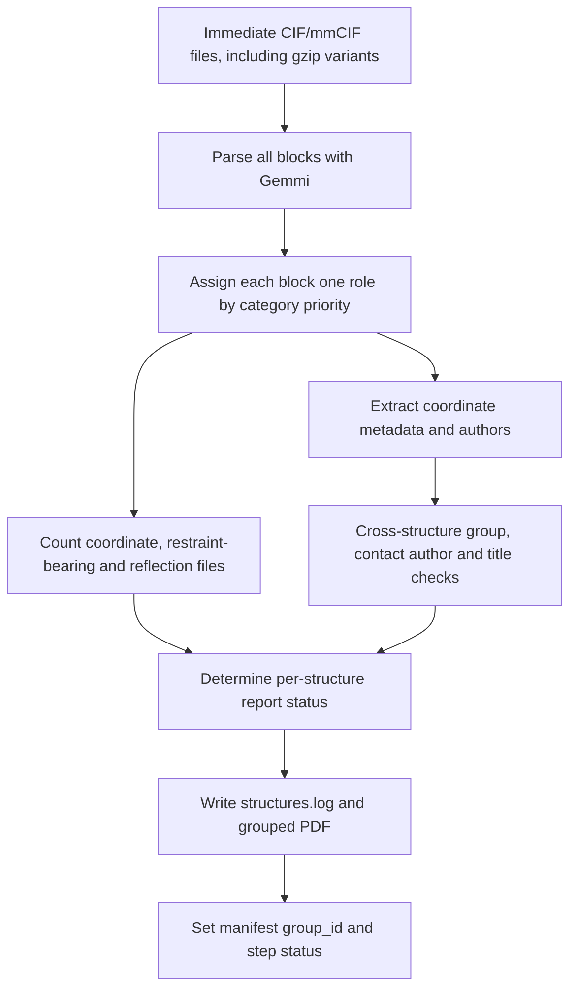

[All commands](index.md) · Previous: [preparation](prepare-dataset.md) · Next: [validation](mmcif-validation.md)

# submission-report

**Wrapper:** `commands/submission_report.py` → **stage:** `stages/prepare_dataset/dep_report.py`.

The wrapper scans only selected active structures, rather than using the standalone stage's immediate-parent-directory scanner.

## Classification and checks

| Priority | Category prefix | Role |
| --- | --- | --- |
| 1 | `_atom_site` | Coordinate |
| 2 | `_refln`, `_diffrn_refln` | Reflections |
| 3 | `_pdbx_chem_comp_audit` | CCD |
| 4 | `_chem_comp_atom` | Restraints |
| 5 | Otherwise | Metadata |

A block gets one role; a multi-block file can have several roles. Shared chemistry categories therefore do not make a coordinate block count again as restraints. File counts differ from block counts.

Checks inspect every coordinate block across the active batch:

- `_pdbx_deposit_group` title, description and type must be present and consistent with the first coordinate block.
- Contact authors must be present and consistent with that first coordinate block; ordered extracted author records are compared.
- `_struct.title` must be present and unique across coordinate blocks.

Author and release metadata are also extracted for report display. These checks are report-specific; they are not the full dictionary validator.

## Status decision

| Conditions | Report and manifest |
| --- | --- |
| Exactly one coordinate file, one reflection file, at least one restraint-bearing file, no unreadable files or validation messages | `OK` → `done` |
| Correct coordinate/reflection counts and no unreadable files, but missing restraints or validation messages | Yellow review label → `failed` |
| Other file/count problems | `Review needed` → `failed` |

**Outputs:** `results/submission_report/structures.log` and `<group-id>_summary.pdf`; manifests include counts, report label and messages. The wrapper sets top-level `group_id`; it does not insert that positional value into coordinate metadata. It prints the relative PDF path.

**Edges:** read errors are captured per file with diagnostic tracebacks. Once the report is produced, the wrapper returns **zero even when structures fail**. Inspect the report/manifest. Missing restraints currently count as failure even for a structure that scientifically needs no new ligand dictionary.
