[Documentation home](index.md) · [Architecture](architecture.md) · [Recovery](recovery.md)

# Files, manifests and identity

## Directory layout

The archive determines the extracted nesting; `pdb_depo_files/` is an example, not a required directory name.

```text
<work-dir>/
├── <dataset>.tgz                     # unless --no-copy
├── pdb_depo_files/
│   └── <structure>/
│       ├── <structure>_struc.cif
│       ├── <structure>_lig.cif
│       ├── <structure>_sf.cif
│       └── manifest.json
└── results/
    ├── submission_report/            # structures.log, <group>_summary.pdf
    ├── ccd/
    │   ├── stage_1/<structure>/      # <component>__001.cif and .png
    │   ├── stage_2/<structure>/      # annotated files, same filenames
    │   └── final/                    # reports, mappings and renamed CCDs
    └── logs/                        # per-stage logs
```

Preparation defaults to `<DEPOSITION_TOOLKIT_WORKROOT>/work/<archive-name-without-extension>`. Relative output paths in manifests are relative to the work directory where possible; paths outside it can remain absolute.

## Structure discovery and file selection

`discover_structure_dirs()` recursively considers the work directory itself and descendant directories. A directory qualifies if it has `manifest.json` or an immediate file matching `*_struc.cif`, `*_struc.mmcif`, `*_lig.cif`, `*_lig.mmcif`, `*_sf.cif`, `*_sf.mmcif`, or `*_sf.ent`.

Paths containing `.git`, `.hg`, `.svn`, `__pycache__`, `.ccd_cache`, `logs`, `results`, `generated_ccd_inputs`, `one-chain`, or `more-than-one-chain` are excluded from the returned structures. Discovery sorts paths without case sensitivity. Processing often keys output directories by the **directory basename**, so different nested structures should have unique basenames.

| Consumer | Actual file rule |
| --- | --- |
| Chain analysis and metadata enrichment | All matching enriched `*_enriched_struc.cif` / `.mmcif` files if any exist; otherwise original `*_struc.cif` / `.mmcif` |
| Submission report | Immediate `.cif`, `.mmcif`, `.cif.gz`, `.mmcif.gz` files; classification uses content |
| mmCIF validation | Recursively all `*.cif` beneath each structure; directory input uses `rglob` even when `recursive=False` |
| CCD creation | Immediate `.cif` files classified by content; exactly one coordinate file and at least one restraint definition |
| Annotation and finalisation | Stage output tree `*/*.cif`, grouped by structure basename |
| Ligand renaming | Both original and enriched coordinate variants, including `.mmcif` |
| Resolution cleanup | Immediate files matching configurable pattern; default `*_struc.cif` |
| Deposition | First sorted match in the first matching pattern: coordinates `*_enriched_struc.cif`, then `*_struc.cif`; SF `*_sf.cif`, `*_sf.mmcif`, `*_sf.ent`, then `r*sf.ent` |

Deposition does not select `.mmcif` coordinates by default. A second coordinate variant is accepted by several commands but makes CCD creation fail its exactly-one-coordinate requirement. File extensions and multiplicity are not uniform across stages.

## Manifest contract

Illustrative fields from a prepared structure and a completed ligand mapping:

```json
{
  "structure_id": "sample-x001",
  "group_id": "G_01",
  "chains": "single",
  "excluded": false,
  "steps": {
    "prepare_dataset": {
      "status": "done",
      "timestamp": "2026-10-28T10:00:00+00:00",
      "source_tarball": "/input/sample.tgz",
      "work_dir": "/processing/work/sample",
      "outputs": ["pdb_depo_files/sample-x001/sample-x001_struc.cif"]
    }
  },
  "ccd_ligands": [{
    "ligand_name": "LIG__001.cif",
    "source_coordinate": "sample-x001_struc.cif",
    "source_block": "model",
    "original_comp_id": "LIG",
    "atom_site_ids": ["1001", "1003"],
    "instance": {
      "label_alt_id": null,
      "label_comp_id": "LIG",
      "label_asym_id": "B",
      "label_entity_id": "2",
      "label_seq_id": null,
      "pdbx_PDB_ins_code": null,
      "auth_seq_id": "401",
      "auth_asym_id": "A",
      "pdbx_PDB_model_num": "1"
    },
    "CCD": "ABC"
  }]
}
```

`instance` records the exact residue, alternate conformation, and model context. Atom IDs are strings and need not be consecutive. `CCD` and `finalisation` are added by the finalisation wrapper; they are absent before successful mapping.

| Field | Writer / meaning |
| --- | --- |
| `structure_id` | Defaults to directory name when missing; used in registry identity |
| `group_id` | Set by submission-report; does not rewrite the coordinate CIF's deposit-group category |
| `chains` | Analysis wrapper writes `single`, `multiple`, `none`, or empty on errors |
| `excluded` | Operator-controlled; wrappers skip truthy values and record `not applicable`; use JSON booleans |
| `ccd_ligands` | Creation stage records instance provenance; finalisation adds codes; optional rename CSV override can update codes |
| `deposition_id`, `session_id` | Deposition wrapper saves known recovery IDs |
| `steps.<step>` | Latest wrapper result, UTC timestamp, outputs/errors, and command-specific details |

Actual step keys are `prepare_dataset`, `submission_report`, `mmcif_validation`, `analyse_chains`, `metadata_enrichment`, `ccd_creation`, `ccd_annotate`, `ccd_finalise`, `lig_rename`, `resolution_cleanup`, and `deposition`.

### Update semantics

`update_step()` replaces the entire selected step object. Other step objects and top-level fields survive. `ensure_manifest()` preserves an existing preparation record using `setdefault`. A missing manifest loads defaults; malformed JSON is an error. There is no versioned manifest schema validation.

Writes use a temporary file in the same directory, flush/fsync, `os.replace`, and directory fsync where available. This prevents partially written JSON; it does not protect concurrent read-modify-write operations. Run one writer per dataset.

Statuses are `done`, `failed`, and `not applicable`. There is no automatic prerequisite check, running state, rollback of upstream transformations, or automatic skipping of already completed steps. Dry-run commands can still write step records and logs.

## Ligand dataflow

```mermaid
flowchart LR
    C[Coordinate atoms and restraint definitions] --> S1[Creation: per-instance CIF and provenance]
    S1 --> S2[Annotation: preserve ligand filenames]
    S2 --> F[Finalisation: group by InChIKey]
    F --> CSV[Per-ligand details CSV]
    CSV --> W[Wrapper joins structure and ligand_name]
    W --> M[Manifest provenance plus CCD]
    M --> R[Rename exact atoms and supported references]
```



Creation clears earlier provenance before rebuilding. The finalisation wrapper clears previous codes before processing. A failed rebuild therefore cannot silently reuse its old mappings. Old files on disk are not automatically removed; review output directories before reruns.

## Deposition identity and PostgreSQL

Registry identity is `(dataset, structure_id)`. `dataset_from_manifest()` uses top-level `source_tarball` or `steps.prepare_dataset.source_tarball`, removes the path and recognized archive suffix, then falls back to `Path.stem`. Missing identity prevents real registry use. Preparation recognizes `.tbz2` / `.txz` specially; deposition's suffix list does not, so those names currently produce different dataset strings.

`deposition_registry` stores:

| Column | Contract |
| --- | --- |
| `id` | Integer primary key |
| `dataset`, `structure_id` | Text, unique as a pair |
| `dep_id` | Remote deposition identifier |
| `session_id` | Local OneDep session UUID; nullable for manual entries |
| `automated_depostion` | Boolean, default true; spelling matches current schema |
| `deposited_on` | Database timestamp with timezone; refreshed on automated upsert |

Pydantic validates nonempty automated identity/registration inputs. A registry entry without a resumable session blocks automatic upload. Upsert updates an existing identity atomically, but lookup plus remote upload is not one database transaction: simultaneous deposit commands can still create competing remote sessions. A registry row records identity, not proof of successful upload; inspect manifest status too.
