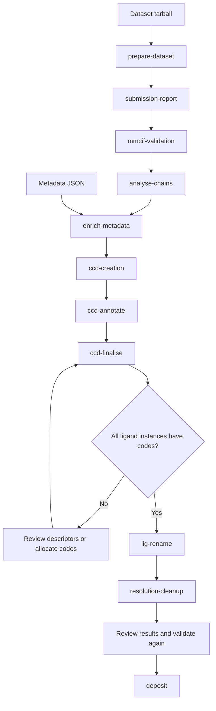

# Deposition toolkit

Prepare crystallographic datasets, inspect and enrich mmCIF files, create chemical component dictionaries (CCDs), and upload structures through OneDep.

This documentation describes the implementation in this repository, including current exceptions and failure behavior. Commands are independent: the sequence below is an operating workflow, not an automatically enforced pipeline.

## Choose a starting point

| I want to… | Read |
| --- | --- |
| Install and process a dataset | [Getting started](getting-started.md) |
| Configure paths, tools, and credentials | [Configuration](configuration.md) |
| Find command arguments and defaults | [CLI reference](cli.md) |
| Understand boundaries and dataflow | [Architecture](architecture.md) |
| Understand files, manifests, and identity | [Data and state](data-and-state.md) |
| Inspect exactly what a command does | [Command internals](commands/index.md) |
| Recover a failed run or assess an edge case | [Recovery and implementation limits](recovery.md) |
| Extend the codebase | [Developer guide](development.md) |
| Publish these pages | [Documentation maintenance and GitHub Pages](publishing.md) |

## Workflow at a glance

`ccd-finalise` defaults to a preview without new code allocation or CVS commits. New ligands need real codes before `lig-rename` can succeed. `deposit` performs real uploads unless `--dry-run` is supplied.

## Terminology

| Term | Meaning here |
| --- | --- |
| Work directory | Extracted dataset plus `results/`; the batch commands' main positional argument |
| Structure directory | Directory containing one structure's files and `manifest.json` |
| Stage | Reusable processing implementation, generally with its own script entry point |
| Command | Toolkit wrapper that selects structures, calls stages, and records batch state |
| Ledger | Toolkit PostgreSQL persistence, currently the deposition registry |
| CCD database | Separate existing OneDep MySQL descriptor source used for ligand matching |
| Ligand instance | Specific residue/conformation/model identified by atom-site provenance; several instances may share one CCD |

Start with [Getting started](getting-started.md), or follow the [architecture overview](architecture.md).
