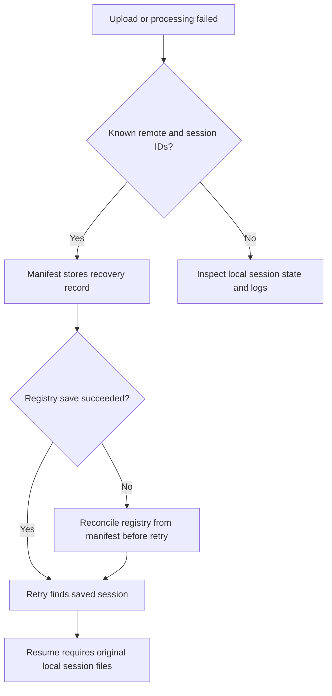

[Documentation home](index.md) · [Command internals](commands/index.md) · [Data and state](data-and-state.md)

# Recovery and implementation limits

## Before retrying

Read the failed structure's `manifest.json`, the referenced logs and the relevant command page. A manifest records the latest step outcome; a retry overwrites that step record. Keep copies of allocation records, reports and source coordinates when they matter for audit/recovery.

| Symptom | Inspect / act |
| --- | --- |
| No active structures | Check discovery patterns and `excluded`; all excluded usually yields exit one |
| Submission report exits zero but reports review | Check per-structure status; zero means report generation completed |
| Missing dictionary | Set `MMCIF_DICTIONARY_PATH` or `--dictionary`; do not infer validity from skipped validation |
| Enrichment failed after writing | Inspect the written CIF and validation log; source is not automatically restored |
| CCD creation sees two coordinates | Its content-based rule requires exactly one immediate coordinate `.cif`; deliberately arrange intended input |
| Annotation fails | Inspect both round logs and tool/license/library paths; executable presence alone is insufficient |
| `PENDING_ALLOCATION` | Review preview, then provide a prior code map or deliberately allocate new codes |
| `EXISTS_IN_DB` | Descriptor source knows chemistry but lacks a component ID; supply a cache with actual IDs |
| Renaming reports changed/missing identity | Do not guess atom mappings; regenerate provenance against intended coordinates and reuse prior code allocations |
| Cleanup succeeds with differences | Examine cutoff logs; differences are not necessarily failing outcomes |
| Deposit registry lookup fails | Check schema, connectivity, manifest identity and nullable-session manual entries; this structure has not begun upload |
| Registry save fails after upload | Use manifest `deposition_record` to reconcile the registry before retrying |
| Resume cannot find session | Restore original OneDep local session files; remote ID alone does not suffice |
| Upload says done, remote completion unclear | Inspect `final_status`; polling exhaustion and `--no-poll` can leave `done` without `finished` |

## CCD allocation retry

Preserve `allocated_ccd_codes.csv` immediately after consuming IDs. Retry with `--code-map-file` so those keys reuse the same codes. If allocations exist across several runs, reconcile them into a reviewed map: the allocator opens its output CSV for writing, not append.

Creation or finalisation can clear manifest code mappings. Do not treat an old manifest mapping as a substitute for matching current ligand provenance. The details CSV can act as a code map because it includes InChIKey and CCD columns.

Stage output trees are not cleaned automatically. Stale stage-1 files may be annotated; stale stage-2 files may be finalised; stale `new_ccds` may enter the commit helper's folder scan. Review those directories against the current manifests and reports.

## Deposition retry

No automatic compensation links OneDep and PostgreSQL. A remote operation may have succeeded before local persistence failed. Do not delete a registry row simply to bypass a resume problem: the next run can create a second remote deposition. A session without a remote ID may exist locally even though the wrapper has not stored it in the registry.

## Current limits to account for when extending the code

These are implementation observations, not guarantees that all related edge cases are covered.

| Area | Current behavior / gap |
| --- | --- |
| Database decoupling | Ledger follows command-boundary design; finaliser's MySQL query remains inside the stage |
| Workflow enforcement | Prior failed stages do not block later commands; no automatic stale-result invalidation across all steps |
| Concurrent runs | Atomic JSON replacement and registry upsert do not lock an entire dataset or remote lifecycle; code-pool rewrite is not locked |
| Identity and paths | Output grouping uses structure basenames; preserve uniqueness. Different archive-suffix helpers can derive different names |
| Validation scope | File selectors and suffix support differ by command; no universal “all inputs validated” guarantee |
| Enrichment | Fixed reference lists, single-block assumption, write before validation, CCD fallbacks can log without failing |
| Chemistry | Zero formal charges in creation output; stereochemistry ambiguity and missing conformer atoms require review |
| Finalisation | Low descriptor-count guard only logs; broad real-code predicate; generated CCD rewrite uses regex |
| Coordinate renaming | Supported categories only; all variants prechecked, but writes are not atomic as a group |
| New uploads | Individual file-check reports are not all gated as they are during re-upload |
| Completion | Successful report/dry-run/preview/upload statuses have different meanings; inspect structured details |

The command internals pages link each issue to its actual branch and outputs. Changes to these behaviors should update the documentation and the relevant regression fixtures together.
